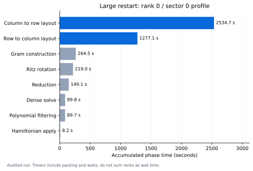

# GPU utilization: why the 64-GB200 repair job differs from the earlier run

The strongest current explanation is **expensive cross-node basis redistribution,
including host staging and synchronization**, compounded by repeated checkpoint
reconstruction and numerical-audit work. The earlier high-utilization job used a
different, node-local GPU pipeline. This is not yet a measured decomposition of
the dashboard percentages into network, host copies and idle time.

The analysis uses a target-job snapshot at **2026-11-15 01:29 PST**, a completed
64-GB200 reference run, and the original timing record of the earlier 16-GB200 run.
No scientific implementation or running allocation was changed for this report.

## 1. Which measurements belong to which job?

The user identified these dashboard averages for
`parsec-restartfix64-gb200-20261113-v2-a030-a001`:

| Dashboard label | User-observed average |
|---|---:|
| GPU utilization | 14.36% |
| SM utilization | 8.93% |
| Tensor Core utilization | 5.57% |

The user also reported higher utilization for
`parsec-overseas-20261111-syd-gb200-cluster_sym-a002`, without providing numeric
averages. The exact dashboard time range, exporter field names and averaging
method have not been exported. The campaign's own one-second sampler records
`memory.used`, not GPU/SM/Tensor utilization. Consequently, this report does not
claim to reproduce those three averages or invent values for the earlier job.

| Property | Earlier, reportedly higher-utilization job | User-observed a030 repair job | Completed profiling reference |
|---|---|---|---|
| GPU allocation | 16 GB200s, 4 nodes × 4 | 64 GB200s, 16 nodes × 4 | 64 GB200s, 16 nodes × 4 |
| MPI processes | 4, one process driving four local GPUs | 64, one process per GPU | 64, one process per GPU |
| Symmetry decomposition | Four sectors; each fits on one node | Four sectors; each spans four nodes | Same cross-node decomposition |
| Representative system | C16257H2268, 67,296 electrons | C23191H2884, 95,648 electrons | C23191H2884, 95,648 electrons |
| Scientific work | Fresh SCF | Fixed-potential restart reconstruction, inherited bound | Restart reconstruction, smart bound |
| Source stage | Baseline `2c96107` | `restartfix` candidate | `restartbounds` candidate |
| Status at recorded snapshot | Converged, 11 SCF steps | Running; eight extra passes collected | Converged after 33 extra passes and one SCF step |
| Recorded attempt time | 540.19 s | No completed attempt time | 5,239.92 s |
| Sampled peak/GPU | 164,769 MiB | No final peak claimed here | 97,105 MiB |

All three use the same recorded GB200 runtime hash
`59067e1e373f0a5e5114cc47c0ad6edcf708ac13ff3eae2248d241fb5ed8b4b8`.
Their system sizes, source versions, topology, solve counts and diagnostic work
are different. Dividing their total times would not measure strong scaling or
the isolated speed of an optimization.

The completed reference is the `smart` case in allocation `b1997f06d39c4cc4`;
the user's a030 job is allocation `87aec9718c253e68`. They are deliberately kept
separate in [utilization_evidence.json](data/utilization_evidence.json).

## 2. What these percentages can and cannot mean

If the dashboard's GPU field uses NVML/`nvidia-smi` utilization, it measures the
fraction of the sampling interval with at least one executing kernel. It is not
the fraction of peak FLOPS delivered. See the
[NVIDIA utilization definition](https://docs.nvidia.com/deploy/nvidia-smi/index.html#utilization).

If the SM and Tensor fields map to DCGM `PROF_SM_ACTIVE` and
`PROF_PIPE_TENSOR_ACTIVE`, they describe SM activity averaged over multiprocessors
and tensor-pipeline activity, respectively. SM activity is distinct from occupancy;
a warp waiting on memory can still count as active. The FP64 pipeline has a
separate counter. See the
[NVIDIA profiling metric definitions](https://docs.nvidia.com/datacenter/dcgm/latest/user-guide/feature-overview.html#profiling).

The field mapping remains to be confirmed for this dashboard. The three values
are not additive, and `100% - 14.36%` cannot be labeled "communication time."
Their ratios also do not yield a reliable conditional SM occupancy without
matching time series and averaging definitions.

For this FP64/complex128 solver, low Tensor Core activity alone does not establish
poor arithmetic performance. Stencils, reductions, data movement and eigensolver
operations are not all tensor-GEMM workloads. Whether an individual FP64 GEMM uses
a particular hardware pipeline depends on the device and library/kernel selection.
The current evidence does not identify every kernel's instruction path. Changing
precision to raise a dashboard percentage would violate the experiment's objective.

## 3. The key architectural difference: where the large basis moves

### Earlier 16-GB200 job

The original timing record confirms four MPI ranks and four local GPUs per rank.
Each rank owns one sector, with `device_groups` mapping that sector to devices
0–3 on its own node. Its distributed-state profile records:

- `pipeline=p2`, `stage_clock=events`, and `exchange_copies=strided`;
- 13 Ritz passes for the completed 11-step SCF;
- node-local basis movement, with MPI used for the higher-level SCF coordination
  and field exchange between sector owners.

Thus, a large sector basis does not repeatedly traverse the inter-node MPI
network during its local four-GPU Ritz calculations. This provides a concrete
reason that GPU arithmetic can occupy more of the execution interval. It does
not prove the physical link type or the earlier dashboard's numeric utilization.

### Current 64-GB200 shared MPI path

Each sector now uses 16 one-GPU ranks across four nodes. The generalized Ritz
implementation converts filtered basis columns and Hamiltonian-applied columns
to row layout, forms the Gram matrices, solves/rotates, and converts back.
Its large basis therefore participates in cross-node collectives repeatedly.

The observed path in
[MPIShardGroup._exchange](../../../src/parsec_python/acceleration/Eigensolvers/mpi_shared_basis.py#L1343)
is:

```text
GPU packing / stream synchronization
  -> device-to-host copy into a contiguous host send buffer
  -> blocking MPI Alltoallv
  -> host-to-device copy into the receive array
  -> stream synchronization
  -> unpacking / next operation
```

`_ritz_inplace` serializes these operations around each exchange round. It saves
large allocations, but does not currently overlap this MPI sequence with useful
work on a second tile. GPU execution can stop while the CPU/MPI path is active;
host/device DMA also need not keep the SMs executing kernels.

The a030 launcher explicitly sets `PARSEC_MPI_SHARED_TRANSPORT=host`,
`MPICH_GPU_SUPPORT_ENABLED=0` and `MPIR_CVAR_ENABLE_GPU=0`. Its network wrapper
sets `UCX_TLS=tcp,sm,self` and `UCX_NET_DEVICES=eth0`, and is byte-identical to the
wrapper used by the completed profiling reference. That UCX policy excludes RDMA
transports if UCX is selected. However, the runtime reports a build supporting
`ch4:ucx ofi`, and the bounded platform query returned no UCX selection log lines.
**The active netmod, selected NIC and physical fabric have not been independently
verified.** Host staging is proven; a specific wire-bandwidth ceiling is not.

The high-utilization older job does not contradict this finding. Its dominant
basis operations remain within a node, so its GPU activity is much less exposed
to inter-node transport, even when higher-level MPI uses host buffers.

## 4. Quantitative evidence from the completed 64-GPU reference

This is the completed smart restart, not the a030 dashboard interval. It uses the
same system size and shared MPI layout implementation and provides a useful
mechanistic reference.

| Rank 0 / sector 0 measurement | Seconds | Fraction of 5,161.30 s diagonalization |
|---|---:|---:|
| Column-to-row conversion | 2,534.67 | 49.11% |
| Row-to-column conversion | 1,277.12 | 24.74% |
| Both conversions | **3,811.79** | **73.85%** |
| Gram construction | 264.51 | 5.12% |
| Rotation | 219.02 | 4.24% |
| Gram reduction | 149.11 | 2.89% |
| Dense solve, waits and coefficient broadcast | 89.84 | 1.74% |
| Filter | 89.67 | 1.74% |
| Hamiltonian apply in the Ritz path | 8.24 | 0.16% |
| Separate eigenpair audits, 36 events | 375.19 | 7.27% |

The combined-conversion row is a subtotal; it must not be added to its two
components. The phase counters do not cover every part of diagonalization.
After these phase timers and the rank-0 audit durations, approximately 153.95 s
remain unassigned. They cannot simply be labeled CPU work or idle time.

Across **all 64 ranks**, the two conversions total 3,806.21–3,936.18 seconds
(median 3,828.50). Relative to the reference diagonalization wall time, that is
73.75–76.26%. Every rank owns a sector share and reports 36 Ritz passes. This is
evidence against a simple explanation that only four ranks were assigned work.
Similar total command durations do not rule out waiting or load imbalance inside
the commands.

Rank 0 records approximately 8.14 TB of logical send payload across the run.
Dividing by its layout time gives approximately 2.14 GB/s, but this is **not NIC
bandwidth**: the counter includes self/local-node sends, and the denominator
includes packing, copies and waiting. Summing ranks would also double-count aspects
of communication and would not produce a whole-job critical-path measurement.



The historical 16-GPU profile reports 12.62 s in `to_rows` and 5.56 s in
`to_columns` for rank 0, with 136.19 s of Gram work and 114.01 s of rotation.
Its diagonalization wall time over all 11 SCF steps is 359.19 s. **Those local
phase timers are overlapping GPU events**, while the MPI reference uses
synchronous host wall timers. Their raw fractions and sums are not directly
comparable. The records support a change in execution structure, not a precise
communication-slowdown ratio between the two jobs.

## 5. Additional contributors and explanations not supported

### Repeated reconstruction magnifies redistribution

The observed a030 path loads density/potential and reconstructs the missing
eigensubspace. At the 01:29 snapshot, eight extra passes had taken 1,140.24 s,
and the maximum level change was 3.05594e-3 Ry, still above 1e-4. No new SCF step
had yet been accepted. Each additional solve repeats Ritz communication; time
spent reconstructing a fixed potential is real work even though the SCF iteration
counter does not advance.

The completed smart reference needed 36 Ritz passes in total: three initial
cycles plus 33 extra passes. The earlier fresh 16-GPU example needed 13. These
are different workloads, not an isolated hardware comparison.

### Memory bounds create many sequential rounds

For an illustrative 12,575,874-row sector with 11,962 working states on 16 ranks,
the **default** 1 GiB `PARSEC_MPI_SHARED_EXCHANGE_BYTES` allows only ten local
columns per exchange round. The code model then gives 75 rounds and three
`Alltoallv` calls per round: approximately 225 collectives per Ritz, or 8,100 for
36 passes, per sector communicator. These are derived counts assuming the stated
defaults, not observed MPI call counts. Overrides, changing dimensions or fallback
paths can change them.

Similarly, 64 MiB dense scratch yields a 701-row rotation tile and about 1,122
rotation tiles per Ritz in this example. The memory-saving design trades large
allocations for finer-grained work and synchronization. Larger tiles might reduce
overhead, but must be measured against extra peak memory and cannot be assumed
to remove the dominant communication cost.

### Auditing is measurable overhead, but not the largest timed component

The completed reference has 36 eigenpair audits per sector leader, approximately
372.79–375.19 s in each sector. These sectors execute concurrently; their times
must not be added as job wall time. The 64 MiB audit budget is below the
301,820,976-byte minimum for three full-grid columns, so the audit uses one column
per tile. It repeatedly applies Hq, reduces norms, copies scalar summaries to the
host and synchronizes. The source is
[debug_audit.py](../../../src/parsec_python/acceleration/Eigensolvers/debug_audit.py).

The target a030 snapshot itself contains 11 rank-0 audit events totaling 116.04 s,
consistent with roughly 10–12 s per audit. This is a direct target-job observation,
separate from the completed reference's total. Production timing should use
`PARSEC_DEBUG=off` after retaining an independent accuracy check; existing diagnostic
comparisons should finish under their frozen settings.

### A CPU-only dense eigensolver is not the observed main cause

a030's `ritz_dense` events explicitly report `backend=device` and `status=passed`.
The completed reference's dense phase is approximately 1.74% of diagonalization,
including coefficient distribution and waits. CPU packing/orchestration can still
matter, but the evidence does not support blaming a global CPU-only eigensolve
for most of the low utilization.

### Capacity limits and low utilization can coexist

Large resident wavefunctions consume memory even while GPUs wait for transfers.
Memory *capacity* is different from memory *bandwidth activity*. The earlier
16-GPU job converged at 67,296 electrons, but its 80,136-electron sample failed
with OOM. More GPUs and reused storage enabled larger examples; this does not
guarantee efficient inter-node scaling.

Startup, checkpoint transfer, readiness checks and time between cases can lower
job-wide averages. Within the completed reference's recorded attempt, however,
5,161.30 of 5,239.92 seconds are diagonalization. Startup alone therefore cannot
explain that attempt's bottleneck. This does not bound pre-launch staging or
explain the exact dashboard interval of a030.

## 6. Proposed next measurements and general optimizations

Keep the **64-GPU target**. The earlier 16-GPU job is a diagnostic reference, not
a proposal to return to only 16-GPU testing.

| Priority | Measurement or candidate | What it distinguishes / acceptance condition |
|---|---|---|
| 1 | Export per-GPU time series with exact time range and metric IDs; align with reconstruction events | Separate allocation-wide idle/staging periods from active reconstruction; do not fill missing samples with zero |
| 1 | Split `_exchange` timing into pack, D2H, MPI, H2D, unpack and synchronization | Quantify host-copy versus collective/wait costs; retain per-rank distributions, not just a sum |
| 1 | Record active MPI netmod/provider, NIC selection, host/GPU topology and available transports | Establish whether RDMA/device-direct communication is actually usable before changing policy |
| 2 | General hierarchical communication: fast node-local GPU movement plus fewer inter-node exchanges | Preserve arbitrary sector/node counts and exactly-once ownership; measure memory and full-SCF accuracy |
| 2 | Reusable bounded staging buffers and safe copy/MPI/compute overlap | Reduce allocation/synchronization overhead without overwriting in-flight buffers or duplicating the full basis |
| 2 | Exchange/rotation tile-size sweep on the same 64 GPUs | Quantify the time/peak-memory trade-off using matched input and solver settings |
| 3 | Fewer redistributions, improved reconstruction or saved eigensubspace state | Reduce repeated work while preserving levels, eigenpair residuals, density and complete SCF behavior |
| 3 | Kernel-level profiling of the remaining compute phases | Identify FP64/GEMM/stencil bottlenecks after communication attribution; do not optimize a dashboard percentage alone |

This should use a short isolated measurement of representative passes before a
complete matched SCF comparison. Preserve one-variable-at-a-time changes, reverse
A/B order where practical, and measure full-device peak memory as well as live
allocations. Existing healthy jobs should not be disturbed to change instrumentation.

As a sensitivity illustration only, if the reference's rank-0 layout fraction
were halved with everything else fixed, Amdahl's law gives approximately **1.59×**
faster diagonalization; quartering it gives approximately **2.24×**. These are
not forecasts: critical-path waits, extra buffers and changed overlap can invalidate
the assumptions. They explain why layout/transport work has higher priority than
trying to raise Tensor Core activity in isolation.

## 7. Evidence and reproducibility

- [utilization_evidence.json](data/utilization_evidence.json): user-reported values,
  confirmed job identity, target debug snapshot, network policy and reference audit totals.
- [old_16gb200_profile.json](data/old_16gb200_profile.json): curated original
  16-GPU result and four-rank profile, including source/runtime/input hashes.
- [large_restart_profile.json](data/large_restart_profile.json): completed 64-GPU
  reference profile; [large_restart_result.json](data/large_restart_result.json)
  records its numerical limits.
- [gpu_utilization_analysis.json](data/gpu_utilization_analysis.json): derived
  ranges, fractions, audit accounting and explicitly hypothetical buffer model.

Regenerate the arithmetic with:

```bash
python examples/0d_nanodiamonds/large_system_experiments/checks/analyze_utilization.py
python examples/0d_nanodiamonds/large_system_experiments/checks/validate_report.py
```

The evidence establishes an expensive cross-node data-movement path and a
material change from the earlier node-local workload. It does **not** establish
that all non-busy GPU time is network transfer, that a particular NIC is saturated,
or that the experimental branch has a measured universal performance regression.
