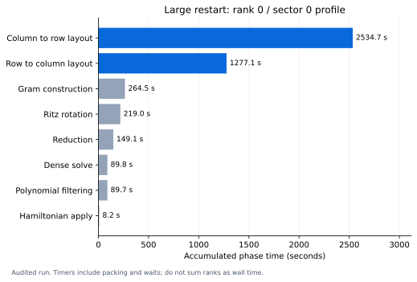

# 从大体系测试得到的优化方向

本文件区分已实现代码、实测效果和下一步假设。对应结果见 [RESULTS.md](RESULTS.md)。
核心要求是保持物理问题和精度设置，减少实际完整计算的时间或峰值显存。

## 1. 显存不是所有 GPU 显存相加后的一个池

设一个 sector 有 $N$ 个网格点、$m$ 个工作态，由 $q$ 个 ranks 分担。
一个 FP64 基组的主要存储约为

$$
M_{basis}\simeq 8Nm/q\quad\text{bytes per GPU}.
$$

complex128 路径相应为 16 bytes/元素；实际还包含不均匀分块 padding、Hamiltonian/
projector、势与密度、通信缓冲、缓存池和库工作区。分布式基组外，leader 上的
稠密 $m\times m$ 矩阵及 eigensolver 仍有 $O(m^2)$ 存储和 $O(m^3)$ 工作。
增加 ranks 并不会等比例降低 leader 的这些分配。

固定密度、固定网格精度时，$N$ 和 $m$ 常随电子数增长，基组内存近似随

$$
M_{basis}\propto N_e^2/q.
$$

因此即便基组完全均匀分布，GPU 翻倍也通常只支持约 $\sqrt 2$ 倍的电子数。
这是规划近似，不适用于直接宣布最大容量；球形真空、sector 不平衡、k-point pools、
稠密矩阵和 QR 回退都会改变实际边界。

## 2. 已实现：让 sector 跨节点分布

相关源码：
[mpi_scf.py](../../../src/parsec_python/acceleration/experimental/mpi_scf.py)、
[mpi_shared_basis.py](../../../src/parsec_python/acceleration/Eigensolvers/mpi_shared_basis.py)、
[symmetry.py](../../../src/parsec_python/acceleration/Eigensolvers/symmetry.py)。

当前这些纳米金刚石的 D2 对称性给出 4 个 sector，这是结构与所用对称群的性质，
不是所有 cluster 永远只能有 4 个 sector。旧的节点内 sector 分配限制了更多节点的利用。
现在当总 rank 数 $P>S$ 时，为每个 sector 建立平衡、连续的 rank group，可以跨节点。
64 ranks / 4 sectors 时每组 16 ranks；在 GB200 的 4 卡节点上，每个 sector 跨 4 节点。

sector 内的过滤、布局转换、Gram reduction 和 Ritz rotation 使用自己的 communicator；
SCF 命令和全局密度求和使用 world communicator。只有 sector leader 上交一次能级元数据，
每个成员只贡献自己持有的轨道列的密度，避免重复计数。
当 $P\le S$ 或混合泛函涉及专门 exchange ownership 时保留对应原路径。

这不是为 C23191H2884 写的固定分工表；测试覆盖非均匀 rank/sector 数、空分块和
恰好一次的元数据汇总。当前仍按 rank 数平衡，没有按各 sector 的实际时间/显存加权。
异构 GPU 的负载平衡也未实现。

## 3. 已实现：稠密中间量与 MPI Ritz 复用

相关源码：
[dense_memory.py](../../../src/parsec_python/acceleration/Eigensolvers/dense_memory.py)、
[rayleigh_ritz.py](../../../src/parsec_python/acceleration/Eigensolvers/rayleigh_ritz.py)、
[chebff_columns.py](../../../src/parsec_python/acceleration/Eigensolvers/chebff_columns.py)。

- 分块镜像下三角，避免整矩阵索引数组或完整 packed triangle。
- 对明确可消费的 Gram 临时量原地求和；公开 API 默认仍保留调用者输入。
- 在后续 workspace 分配前释放已经使用完的 whitening/factor/vector 中间量。
- 广播到最终 Fortran-order 分配，避免再复制一份系数矩阵。
- `PARSEC_DENSE_BUFFER_BYTES` 限制每块通信 scratch，默认 64 MiB；它不是进程总内存上限。

`PARSEC_MPI_SHARED_RITZ=inplace` 让列分布与行分布共用一份大分配：反向 exchange rounds
在发送完成后复用已消费空间，独立 row tiles 原地旋转，再逐轮恢复列分布。
padding 按实际不均匀布局计算，trim 后也要仍然足够。没有足够 padding 的外部数组
保留分配新 row block 的路径，并在计时记录中计数。

稳定性检查不通过时，必须先逐位恢复原过滤列，再进入原有 fallback。
减少显存不能以覆盖仍在使用的输入、异步传输过早释放缓冲或改变正交化门槛为代价。
`auto` 的库默认策略没有被改成强制实验模式；本次 memory-v2 显式指定 `inplace`。

实测模块存储减少与 64 H100 的大体系容量结果见 RESULTS；尚没有把所有时间回归都
归因清楚。改变 reduction 分组会改变舍入顺序，不能要求所有物理情况下逐位一致。

## 4. 已实现候选：robust QR 也复用大基组

125,272 电子恢复路径曾在已有约 116.04 GiB 活跃存储时，再请求约 115.12 GiB
的行基组，在 184.31 GiB GB200 上失败。普通 Ritz 使用一份存储，并不意味着
稳定性回退也只用一份；这种峰值只在大体系或困难子空间中显现。

`PARSEC_MPI_SHARED_QR=inplace` 让三遍 shifted Cholesky QR 使用原分配，
通过有界 row permutation 和 triangular solve 保留原移位、条件检查及后续 Ritz。
默认仍为 `rows`。仅针对实数 shared-basis 的 cluster/Γ 路径，不能把结果外推为
复杂 k 点的 QR 优化。

64 GB200 的 QR+Ritz 模块测试减少 25.54% 活跃内存，精度和两个短完整 SCF 对照通过；
小体系程序峰值没有下降，125,272 电子完整精度验证尚未完成，所以保持候选状态。

## 5. 已实现候选：固定势重建及 smart 下界

相关源码：
[restart_refinement.py](../../../src/parsec_python/SCF/restart_refinement.py)、
[restart.py](../../../src/parsec_python/SCF/restart.py)、
[kpoints.py](../../../src/parsec_python/SCF/kpoints.py)。

健康势的 checkpoint 不等于已经恢复了健康本征子空间。原先固定 3 次首轮过滤可能
没有把新随机子空间重建好，得到的坏密度随后污染混合过程。增加计算轮数明显改善
恢复首步，是目前支持该诊断的主要证据。

`levels` 策略保持 Hamiltonian 不变，额外求解直到所有请求能级连续两轮稳定，
只保留 O(states) 的主机能谱快照；不复制另一整套波函数。到达 40 轮仍不满足时
在构造/混合新密度前失败，不能把此时的 checkpoint 自动提升为健康父状态。

进一步的 `smart` 只调整额外重建阶段的滤波下界。旧 monotone 下界在大体系中
一直保留早期约 +0.193 Ry 的值；新策略跟随当前 Ritz 能谱，后期约 −0.064 Ry。
初始求解、普通 SCF 的设置对象、次数、精度和验收门槛不变；但重建的 subspace
及其 bound history 会保留，后续数值轨迹不承诺逐位一致。

scalar/sector 与 built-in k-point/spin 路径共用策略。k-point 的设置 factory 在
成功或异常退出后都恢复；没有 KPointJob 的自定义 solver 显式拒绝该 override。
spin-orbit checkpoint 的此项重建尚不支持。

CPU 独立实数/复数谱测试中，移位谱的轮数从 47/50 降到 10/11；小型物理 k 点
与 ARPACK 的能级差约 1e−14 Ry。这些数值不能换算成大 GPU 加速。
实际 95,648 电子 smart 用了 33 轮，已完成原标准的 SCF 收敛；大体系 inherit
同分配对照和最终数组精度比较仍未结束。

## 6. 下一阶段：优先验证数据重分布优化

本次已完成的大体系重启提供了具体计时依据：

| rank 0 / sector 0 阶段 | 累计秒数 |
|---|---:|
| to_rows | 2,534.67 |
| to_columns | 1,277.12 |
| Gram 构造 | 264.51 |
| rotation | 219.02 |
| reduction | 149.11 |
| dense solve | 89.84 |
| filter | 89.67 |
| apply | 8.24 |

两次布局转换合计 3,811.79 秒，相对于 5,161.30 秒的对角化约为 73.85%。
单个 rank 报告的 exchanged bytes 为约 8.14e12，表示代码计数口径下的累计交换量，
不是整机网络吞吐量。阶段包含 packing、host/device 搬运、collective 等待；不同 ranks
与阶段的计时不能简单相加成 wall time。它只描述这次 audit 开启的重启 workload。

优先候选如下；目前都没有实测收益结论：

1. **减少重分布次数或保留可复用布局。**调查能否跨 Ritz 步复用 row/column 状态，
   或合并连续的 exchange rounds。要明确哪些数据仍被 Hamiltonian、密度和后续
   filter 使用，避免用少通信换来多份大基组。
2. **通信与计算重叠。**在不改数学运算与精度的前提下，对安全的 tiles 双缓冲并重叠
   CPU/GPU 复制、MPI 和局部 Gram。新增 buffers 的峰值必须一并测量。
3. **验证更合适的传输路径。**本次显式 host staging；先核实环境是否支持正确的
   CUDA-aware MPI/设备通信，再作同配置 A/B，不能仅把环境变量改为 cuda 就宣称可用。
4. **减少重复重建工作。**评估序列化 eigensubspace/波函数或中间重建状态的成本、
   容量和跨 GPU 可移植性。只存 density/potential 无法保留重建内已经完成的几十轮。
5. **更一般的布局与负载均衡。**按 sector/k-point 的状态数、内存和实测耗时分配
   ranks，而不是把当前 4 sector 的分配固定到某一个结构。
6. **更大的稠密问题。**若 leader 的 $m^2$ 存储或 $m^3$ 求解成为主要瓶颈，
   再研究 distributed dense eigensolver；目前 profile 不支持把它排在布局转换之前。

## 7. 每阶段的采用标准

每个候选独立开关、独立冻结，保留同输入/同健康父状态的 control。
首先验证完整 SCF、能量（总量和每电子）、密度、电荷、占据与空态能级，以及实际
本征对残差。然后在同一分配上关闭 audit 测时间，交换 A/B 顺序并重复，报告范围。
显存至少同时记录活跃 allocation 和全卡采样峰值。

明显时间回归不能仅用一个小的内存改善来掩盖；明显内存回归也不能仅用计时噪声
解释。若一项代价换来另一项大幅收益，明确报告比例和适用规模，由实验结果决定
是否采用。先交付已验证的 family/规模，再扩展到更大 cluster、Γ 和复杂 k 点。
