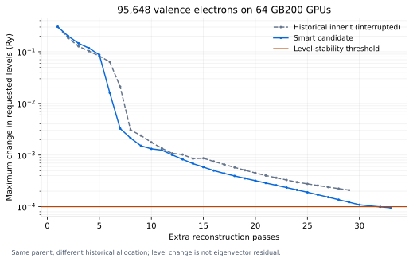

# 实验结果与证据范围

科学状态截至 2026-11-15 00:46 PST。数据入口为 [runs.csv](data/runs.csv)，
每条记录有稳定的 `record_id`；带哈希的详细字段见 [runs.json](data/runs.json)。

## 1. 使用了哪些资源

| GPU | 实测可见显存/卡 | CPU 架构 | 每节点可见 GPU | 本轮使用规模 | 分配性质 |
|---|---:|---|---:|---|---|
| A100-SXM4-80GB，既有 NERSC 基准 | 79.25 GiB | 参见原基准 | 4 | 1–16 GPU，最多 4 节点 | 历史基准 |
| H100 | 约 79.11 GiB | x86_64 | 8 | 16 卡短校验，32/64 卡容量测试 | 海外可抢占 |
| H200 | 约 139.80 GiB | x86_64 | 8 | 16 卡模块和短校验 | 海外可抢占 |
| GB200 | 约 184.31 GiB | aarch64 | 4 | 8 卡早期校验，64 卡主要实验 | 海外可抢占 |

64 GB200 的实际拓扑是 **16 节点 × 4 卡**；64 H100 是 **8 节点 × 8 卡**。
不能仅凭“64 卡”认为拓扑或网络相同。国内 64 A100 申请曾因排队被停止，本报告
没有该申请完成计算的结果；H200 也没有足够证据给出 64 卡大体系上限。

运行时记录见 [hardware.json](data/hardware.json)：Python 3.12.4、NumPy 2.2.6、
SciPy 1.15.3、CuPy 14.2.0、mpi4py 4.1.1；主要 GB200 发布包使用 MPICH 4.3.2，
native 扩展 0.6.1。MPI 数据路径明确选择 host staging。
64 卡任务每次分配最多 8 小时；可抢占资源不保证持续使用。

## 2. 体系、精度和电子数

cluster 使用理想金刚石截球并氢饱和的 C/H 结构，大结构未做新的几何弛豫。
价电子数为 $N_e=4N_C+N_H$，不是原子序数总和。

| cluster | C/H 数目 | 原子数 | 价电子数 | 球半径 | 请求能级数 |
|---|---|---:|---:|---:|---:|
| k11 | C4601H988 | 5,589 | 19,392 | 28.0 Å | 9,702 |
| k18 | C19395H2556 | 21,951 | 80,136 | 见冻结输入记录 | 见该运行输入 |
| k19 | C23191H2884 | 26,075 | 95,648 | 45.8 Å | 47,830 |
| k20 | C26469H3148 | 29,617 | 109,024 | 48.5 Å | 54,518 |
| k21 | C30457H3444 | 33,901 | 125,272 | 49.4 Å | 62,642 |

cluster：LDA/Ceperley–Alder、网格 0.20 Å、八阶有限差分、500 K Fermi–Dirac。
周期体系：PBE bulk diamond，常规晶胞每个 8 个 C，复制 $n_1n_2n_3$ 次后

$$
N_{atoms}=8n_1n_2n_3,\qquad N_e=32n_1n_2n_3.
$$

周期网格为 0.37448072665553 bohr（约 0.198 Å），八阶有限差分。
`k2`/`k3` 指 2×2×2 / 3×3×3 Monkhorst–Pack 网格，不能和结构复制次数混淆。
代码实际使用对称性约化后的 k 点及其权重；不把 $N_e$ 乘以 k 点数。

原精度设置一直保留：`Convergence_Criterion=2e-4 Ry`、`Diag_Tolerance=1e-4`、
FP64/complex128。初始 CHEBFF 为 3 轮、次数 30，后续 SUBSPACE 次数 15；
原有条件数检查、正交化回退和混合设置仍有效。cluster 与周期 C 赝势不同，
各自哈希在 [inputs.json](data/inputs.json) 中，不可互换。

## 3. 已完成的大体系与失败样本

下表是**所选已完成样本和相邻失败样本**，并不是完整的二分容量搜索。
所有行均为 64 GPU；计时只覆盖该条已记录的运行尝试，不含排队和此前中断的工作。

| 版本/资源 | 体系 | 价电子数 | 结果 | SCF 步数 | 本次耗时/s | 峰值 MiB/卡 |
|---|---|---:|---|---:|---:|---:|
| memory-v2 / H100 | cluster C19395H2556 | 80,136 | 收敛 | 12 | 3,957.20 | 72,727 |
| memory-v2 / H100 | cluster C23191H2884 | 95,648 | OOM | — | 146.89 | 未完整回收 |
| memory-v2 / H100 | Γ，11×11×11 | 42,592 | 收敛 | 12 | 3,764.06 | 75,297 |
| memory-v2 / H100 | k3，8×8×8 | 16,384 | 收敛 | 10 | 2,447.04 | 74,901 |
| memory-v2 / H100 | k3，9×9×9 | 23,328 | OOM | — | 143.14 | 未完整回收 |
| memory-v2 / GB200 | cluster C23191H2884 | 95,648 | 从头计算收敛 | 14 | 2,360.24 | 97,057 |
| memory-v2 / GB200 | cluster C26469H3148 | 109,024 | 恢复过程中 OOM | — | 989.68 | 未完整回收 |
| memory-v2 / GB200 | cluster C30457H3444 | 125,272 | 恢复过程中 OOM | — | 1,226.84 | 未完整回收 |
| memory-v2 / GB200 | Γ，13×13×13 | 70,304 | 恢复后收敛 | 10 | 2,734.98 | 185,689 |
| memory-v2 / GB200 | Γ，13×13×14 | 75,712 | OOM | — | 554.07 | 未完整回收 |
| memory-v2 / GB200 | k2，10×10×10 | 32,000 | 从头计算收敛 | 8 | 5,173.08 | 148,971 |
| memory-v2 / GB200 | k2，11×11×11 | 42,592 | OOM | — | 89.69 | 未完整回收 |
| memory-v2 / GB200 | k3，11×11×11 | 42,592 | OOM | — | 89.72 | 未完整回收 |

例如，70,304 电子 Γ 点的 185,689 MiB 已很接近本次 GB200 可见容量；
cluster 的失败还受到是否触发第二份大基组的 QR 回退影响。因此，同一卡数的
“最大电子数”必须同时注明体系类型、网格、k 网格、对称性、源码和运行路径。
仅仅初始化成功、保存过一个 SCF checkpoint 或未出现 OOM，都不算容量验证完成。

已有 16 A100 基准中的 C9449H1572 为 39,368 电子，10 SCF 步、程序时间 208.5 秒、
峰值约 60.0 GiB。该基准使用 node-local 软件/缓存和不同拓扑、计时口径，
不能拿它与表中的 TaskKit 端到端时间直接计算 GPU 加速比。

## 4. 已测得的优化效果

### 4.1 完整 SCF：memory-v1

同一 C4601H988 输入、相同运行时、无对称性、64 H100：

| 指标 | 基线 | memory-v1 |
|---|---:|---:|
| SCF 步数 | 11 | 11 |
| 总能量/Ry | −53752.0912609566 | −53752.091260952875 |
| 最大采样显存/MiB | 61,269 | 42,989 |
| 本次端到端耗时/s | 1,350.6375 | 1,827.5936 |

显存降低 29.84%，总能量差 $3.7253\times10^{-9}$ Ry；观察到时间增加 35.31%。
两条来自不同分配，包含通信与 checkpoint I/O，所以不能把时间变化完全归因于
某一个 kernel。本结果支持“降低显存”的效果，但尚不足以按时间/显存 trade-off
要求无条件采用。数据：[full_scf_memory_pair.json](data/full_scf_memory_pair.json)。

memory-v1 的 64 H100 / 80,136 电子 cluster 曾 OOM，而 memory-v2 的该规模已收敛。
这是容量改善的实测线索；精确的性能归因仍需相同分配上的匹配 A/B。

### 4.2 模块级临时内存

| 测试 | 配置 | 旧→新活跃内存/bytes | 降低 | 精度证据 |
|---|---|---:|---:|---|
| dense generalized Ritz | 4,096 states，GB200/H100/H200 | 1,615,072,768→1,212,419,584 | 24.93% | 能级差 0，符号对齐向量差 0 |
| MPI Ritz | 131,071 rows、257 states，8 GB200 | 82,977,280→49,291,776 | 40.60% | 能级/对齐向量差 0 |
| MPI Ritz | 同形状，16 H100/H200 | 47,260,160→30,417,408 | 35.64% | 能级差 0，向量差约 1.73e−17 |
| robust QR + 后续 Ritz | 524,287 rows、509 states，64 GB200 | 100,418,560→74,766,848 | 25.54% | 能级/对齐向量差 0，正交误差约 2.66e−15 |

这里测量 CuPy **活跃分配**，不含 CUDA context/library 内存，不等于 `nvidia-smi`
或完整 SCF 的峰值。QR 两次交换先后顺序的时间比为 1.351 和 0.869，方向相反，
所以没有可靠提速结论。数据：[module_comparisons.json](data/module_comparisons.json)。

QR 小体系完整 SCF 的 Γ-256 和 cluster-3,480 均通过能量、密度和电荷比较，
但程序峰值分别仍为 921/1,857 MiB。临时存储节省并未在这两个小样本中转化为
程序峰值下降。数据：[qr_full_scf_pairs.json](data/qr_full_scf_pairs.json)。

## 5. checkpoint 重建与最新候选

当前实验的 `parsec.dat` 路径恢复电荷/势/能级，不恢复波函数、完整本征子空间和
混合器历史。代码另有波函数相关 I/O 能力；不能据此说“整个仓库都不能保存波函数”。
这里讨论的是本次实际使用的恢复路径。

对 125,272 电子的健康 SCF-5 checkpoint，首轮过滤 3 次时恢复后的 SCF residual
曾为 9.0906888391；改为 6 次后为 0.1377455741，约小 66 倍，6 次中未见 QR 回退。
这支持“缺失子空间的重建不足”是重要因素，但并不单独证明全部发散原因或修复完成。

`PARSEC_RESTART_REFINE=levels` 在固定载入势下额外求解，全部请求能级连续两轮
变化不超过输入 `Diag_Tolerance` 才允许构造新密度；最多 40 轮，失败即退出。
新候选再用 `PARSEC_RESTART_REFINE_LOWER_BOUND=smart`，只在额外重建阶段使用
已有的动态滤波下界规则。原次数、FP64、物理参数和最终 SCF 门槛未放宽。

### 5.1 同一分配上的短对照

| 体系 | 电子数 | inherit→smart 耗时/s | 总能量差/Ry | 峰值 MiB/卡 |
|---|---:|---:|---:|---:|
| Γ | 256 | 37.3399→33.2425 | 0 | 917→917 |
| cluster C795H300 | 3,480 | 43.3704→41.5646 | +2.79397e−9 | 1,857→1,857 |

两边均从各自相同的健康父 checkpoint 出发，一个恢复后 SCF 步收敛。
Γ 的最终数组指纹也一致；cluster 指纹不完全一致，逐数组数值比较仍待补齐。
这是 audit 开启的单次对照，不能据此宣称稳定的 11% 或 4% 加速。

### 5.2 95,648 电子的 smart 重启已完成

- 16 节点 × 4 GB200，64 MPI ranks，4 sector 各 16 ranks。
- 33 轮额外重建，4,729.07 秒；最后最大相邻能级变化 9.53870e−5 Ry，
  连续两轮满足 1e−4 的重建门槛。
- 随后一个 SCF 步收敛：weighted residual = 6.65673e−5，原门槛 2e−4。
- 本次端到端耗时 5,239.92 秒，报告程序时间 5,204.62 秒，单卡采样峰值
  97,105 MiB = 94.83 GiB。
- 总能量 −268541.72651565075 Ry；相对于健康父结果 −268541.7257309258 Ry，
  差值为 **−7.84725e−4 Ry**，每价电子 −8.20430e−9 Ry。总量与每电子值同时报告。
- 密度积分为 95,648.00000000525，occupation 电荷为 95,648.00000000003；
  最终密度、势、能级和 occupations 的指纹报告均为有限值。
- 四个 sector 的实际工作态最大 $\|Hq-\epsilon q\|$ 为约 0.00717–0.00815 Ry。
  **能级变化门槛不是本征向量残差门槛**，不能把 1e−4 当作所有工作态残差的证明。

同一分配的 inherit 对照紧接着运行，报告快照时尚未完成。最终密度/占据能级的
数值差异、完整 A/B 时间比和重启后的继续演化仍需检查。
一次从已收敛父状态恢复后收敛，不代表从头算同等规模只需一个 SCF 步。
历史从头 14 步用时 2,360.24 秒，与此次严格重建的 5,239.92 秒不是速度 A/B。

历史 inherit 曲线到 29 轮后中断，不能补画收敛点。相同 20 轮时 smart 的相邻
能级变化低约 29.23%，但单轮耗时相近；这只是过程指标的改善。
数据：[large_restart_result.json](data/large_restart_result.json)、
[reconstruction_curve.csv](data/reconstruction_curve.csv)。

## 6. 尚不能宣布的结论

当前没有“所有 cluster/Γ/k 点都提速”的结论，没有 64 A100/H200 的完整容量上限，
没有证明 robust QR 候选已让 125,272 电子体系完整收敛，也没有用一次小体系时间比
替代大体系的匹配实验。分配中断的原因若平台未明确给出，就记录为中断/失败，
不自动称为抢占。测试分支保留这些边界，正式采用需逐项完成精度和收益审查。
